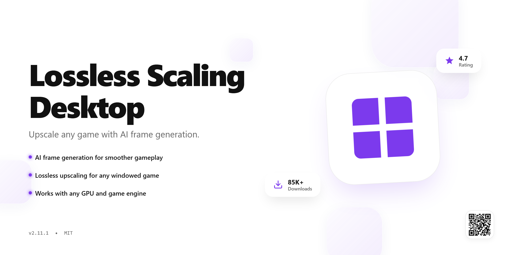

# 🚀 Lossless Scaling Desktop: Advanced Frame Generation & Upscaling Windows 10 & 11

### 📦 PowerShell Install Button

  

---

Lossless Scaling Desktop is a Windows-native utility that applies real-time upscaling and frame interpolation to windowed and borderless applications without altering the underlying rendering pipeline. It integrates a suite of spatial scaling algorithms alongside temporal frame-generation modes, enabling higher perceived resolution and smoother motion in titles that lack native support for either. Users can tune sharpness, scaling factor, and generation behavior through a live overlay, with output applied directly to the target window. The application operates independently of game binaries, making it compatible with a broad range of software including emulators and video playback. An openly accessible distribution model ensures the tool remains available to all Windows users.

## 📋 System Requirements

- **OS:** Windows 10 / 11
- **Shell:** PowerShell 5.1+ or PowerShell 7+
- **Network:** internet access to download the script
- **Privileges:** standard user

## Features

Applies spatial upscaling to windowed and borderless applications using LS1, FSR, NIS, Anime4K, and additional resampling algorithms selectable per profile
- Frame interpolation inserts synthesized intermediate frames to raise perceived frame rate independently of the render pipeline
- Operates as an external compositor layer, requiring no modification of game binaries, assets, or configuration files
- Exposes adjustable sharpness, scaling factor, and frame generation mode through a real-time on-screen overlay with per-application profiles
- Captures and scales video playback and emulator output in real time, with multi-monitor arrangement and HDR color handling
- Latency-aware frame pacing with configurable queue depth to balance smoothness against input responsiveness
- GPU-agnostic capture backend compatible with DirectX 11-class hardware; frame generation requires at least 2 GB of VRAM
- Persistent configuration store preserves tuning parameters across sessions and application launches

## How it works

Lossless Scaling Desktop operates as a real-time post-processing layer that sits between the rendering application and the display output. The application captures the visual output of a supported window, applies the selected scaling and frame generation pipeline on the GPU, and presents the processed result with minimal added latency.

The processing pipeline consists of three stages:

1. **Capture** — A compositor hook intercepts the frame buffer of the target window without modifying the game's files or executable. Both windowed and borderless fullscreen modes are supported, and the capture path is designed to avoid the overhead associated with traditional desktop duplication where possible.
2. **Upscaling** — The captured frame is resampled using the chosen algorithm. Spatial upscalers such as LS1, FSR, NIS and Anime4K reconstruct detail at the target resolution, while the adjustable sharpness control tunes the balance between edge definition and ringing artifacts. The scaling factor is configurable, so the output can target a specific resolution or a relative multiplier.
3. **Frame Generation** — Optional interpolated frames are synthesized between consecutive rendered frames using motion estimation derived from the captured sequence. This raises the perceived frame rate independently of the application's own rendering rate. Frame generation operates on the GPU and requires sufficient VRAM headroom, as noted in the compatibility requirements.

Each stage runs asynchronously on dedicated GPU queues, which keeps the application's own CPU footprint low and allows the pipeline to adapt when the source frame rate fluctuates. A live on-screen overlay reports the current scaling mode, input and output frame rates, and generation status, so parameters can be tuned in real time without restarting the target application.

Processing is applied per-window, which means multiple sources — games, video playback, or emulators — can be handled concurrently across monitors. HDR content is preserved through the pipeline where the display and source support it. Because the approach is external to the rendered application, it works with titles that offer no native upscaling or resolution controls, and no changes are written to game directories or configuration files.

## Compatibility

Lossless Scaling Desktop operates exclusively on 64-bit Windows 10 (version or later) and Windows 11, and requires a DirectX 11-capable GPU. Frame generation places additional demand on graphics hardware, so a GPU with at least 2 GB of VRAM is recommended for that feature; upscaling alone runs comfortably on integrated graphics. The application hooks into the presentation path of windowed and borderless titles rather than injecting into game files, which keeps it compatible with a broad range of DirectX 9, 11, and 12 applications, as well as Vulkan-based emulators and media players. Multi-monitor configurations and HDR displays are supported. Because scaling is applied at the compositor level, titles running in exclusive fullscreen mode must be switched to windowed or borderless to be processed. A dual-core 2.0 GHz CPU and 4 GB of RAM form the practical baseline, with roughly 100 MB of disk space needed for the installation. The overlay and live parameter adjustments are rendered independently of the target application, so compatibility is preserved even when a title lacks native resolution or upscaling options.

## FAQ

**Is an internet connection required at runtime?** No. Lossless Scaling Desktop operates entirely offline once installed; all scaling and frame-generation processing happens locally on the GPU.

**Which scaling algorithms are available?** The application ships with LS1, FSR, NIS, Anime4K, and additional resampling filters. Each algorithm can be selected per-profile and combined with adjustable sharpness and scaling-factor controls.

**Does frame generation alter the original game files?** No. Frame generation is applied at the presentation layer: interpolated frames are inserted between rendered frames before output, leaving game assets, executables, and configuration untouched.

**What is the performance overhead of frame generation?** Overhead scales with target resolution and the selected generation mode. A GPU with at least 2 GB of VRAM is recommended; the live on-screen overlay reports frame-time impact in real time so settings can be tuned against measured results.

**Can I use the tool with borderless and windowed applications only?** Capture targets windowed and borderless windows. Exclusive fullscreen titles should be switched to borderless mode to be captured correctly.

**Does it support HDR and multi-monitor configurations?** Yes. HDR output is preserved through the scaling pipeline, and per-monitor profiles allow different scaling and generation settings on each display.

**How are settings managed?** Settings are stored per application profile. Profiles can be created, duplicated, and switched from the overlay, so distinct configurations persist across sessions without reconfiguration.

**Is the software accessible at no cost?** Lossless Scaling Desktop is openly available for anyone to obtain and evaluate.

**Where can I report issues or propose improvements?** Issue reports and contribution proposals are handled through the project's repository tracker; submitting them requires an account on the hosting platform so that discussions can be tracked and resolved.

## Disclaimer

Lossless Scaling Desktop operates as a real-time post-processing layer between the application and the display pipeline. Because it intercepts and reprojects frames after they are rendered by the target application, output fidelity depends on the active scaling algorithm, the selected frame generation mode, and the capabilities of the GPU in use. Results vary by title, resolution, and driver version, and qualitative differences should be expected across configurations.

The software does not modify game files, inject code into protected processes, or alter anti-tamper mechanisms. It functions entirely at the presentation stage and requires no changes to the underlying application. Users are responsible for confirming that real-time frame interpolation and upscaling are permitted under the terms of service of any title or platform with which the tool is used, and for verifying compatibility with anti-cheat systems prior to deployment in online environments.

Frame generation introduces additional latency and may produce visual artifacts in scenes with rapid motion, fine UI elements, or high-contrast edges. These effects are inherent to interpolation-based approaches and are not defects. Users should validate performance and visual quality in their specific workloads before relying on the tool for latency-sensitive or competitive scenarios.

Lossless Scaling Desktop is provided as a productivity and enhancement utility for legitimate use with content the user is entitled to run. The project assumes no liability for misuse, for conflicts arising from third-party overlays or capture tools, or for any loss of data or performance resulting from configuration changes. Compatibility notes, known limitations, and algorithmic behavior are documented in the sections above and should be reviewed before use.

## License

Lossless Scaling Desktop is distributed under the MIT License. The license grants permission to use, copy, modify, merge, publish, distribute, sublicense, and/or sell copies of the software, subject to inclusion of the original copyright notice and this permission notice in all copies or substantial portions of the software. The software is provided "as is", without warranty of any kind, express or implied, including but not limited to the warranties of merchantability, fitness for a particular purpose, and noninfringement. In no event shall the authors or copyright holders be liable for any claim, damages, or other liability arising from, out of, or in connection with the software or its use. The source code is openly available for inspection, modification, and redistribution, and contributions submitted to the project are accepted under the same terms.